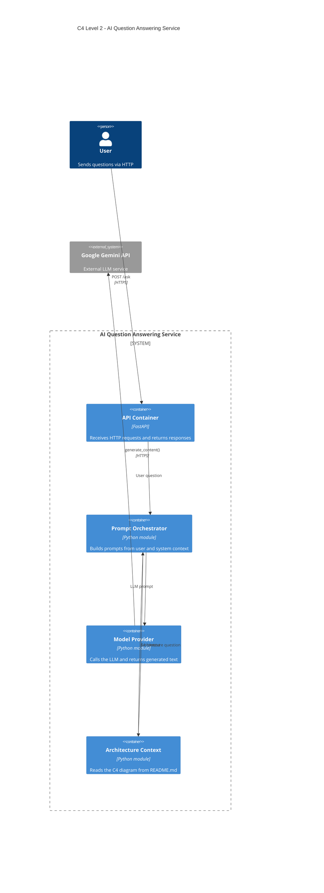

# AI Question Answering Service

[](https://github.com/Nikko-1019/ai-architecture-nextwork/actions/workflows/architecture.yml)

## Architecture



## Part 2 starter scaffold

Part 2 adds a support issue triage service in `app/` alongside the Part 1 files, which stay unchanged at the repository root.

### Supplied for you

| File | Purpose |
| --- | --- |
| `app/models.py` | Validated request, suggestion, and decision models |
| `app/model_provider.py` | `ModelProvider` protocol and the Gemini implementation (the only file that imports the Gemini SDK) |
| `app/main.py` | FastAPI app exposing `POST /triage` |
| `evals/issues.json` | Ten frozen support issues with their expected decisions |
| `evals/helpers.py` | Fixture loader |
| `evals/test_tier_a.py` | Tier A: deterministic policy evaluation |
| `evals/test_tier_b.py` | Tier B: orchestration guardrails, using a stub provider |
| `scripts/call_triage.py` | Sends a demo issue to a locally running API |
| `.github/workflows/evaluation-gate.yml` | Partial CI evaluation gate (manual trigger for now) |

### Where your work goes

Search for `TODO` in these files:

- `app/triage_rules.py`: three policy TODOs about rule precedence and human overrides.
- `app/orchestrator.py`: three guardrail TODOs about overrides, provider failures, and priority downgrades.
- `.github/workflows/evaluation-gate.yml`: two TODOs that turn the manual workflow into a real gate.

### Failing evaluations are the starting point

On a fresh fork, both suites fail on purpose:

- **Tier A** (`python -m unittest -v evals.test_tier_a`) reports assertion failures because the starter policy has no precedence for overrides, security, or wide-impact issues.
- **Tier B** (`python -m unittest -v evals.test_tier_b`) reports assertion failures, once Tier A passes, because the orchestrator has no guardrails yet.

Every failure names the issue ID it comes from. Fix the code, not the expectations: do not edit `evals/issues.json` to make a test pass.

### Running locally

```bash
python -m venv .venv
source .venv/bin/activate
python -m pip install -r requirements.txt
cp .env.example .env   # add your own key; .env is git-ignored and must stay local
uvicorn app.main:app --reload
python scripts/call_triage.py   # in a second terminal
```

Neither evaluation suite needs a Gemini key or network access, and CI runs them with frozen fixtures and a stub provider instead of a credential.
